# Architecture: Demo Bank assistant

A multi-agent banking assistant. A coordinator agent hands each question to a specialist; the
specialists use bank tools served over MCP; the bank is the Open Bank Project (OBP) sandbox for the
two demo customers, or a visitor's own pretend bank. It runs on AWS in Ireland, open 09:00-17:00.

This page explains how the parts fit together. For setting it up step by step, see the
[setup guide](SETUP.md); for an overview with results, the [README](README.md).

> **In this copy (self-hosted vLLM):** everything below holds for the agents, tools, approvals,
> guardrails, tracing and evals. Two things differ. The model is served by vLLM on our own GPUs
> (`MODEL=vllm:...`, [agents/vllm_chat.py](agents/vllm_chat.py)): every call carries the
> conversation's `x-session-id`, so the router keeps it on one GPU with its prefix cache, and a
> per-customer `cache_salt`. And the deployment is a single GPU machine
> ([deploy/phase0](deploy/phase0/README.md)) or Amazon EKS ([deploy/k8s](deploy/k8s/README.md))
> instead of the Fargate set-up in section 3. The plan behind it, with its benchmarks, is the doc
> "Self-hosting the banking agent on Kubernetes with vLLM".

**Contents**

1. [At a glance](#1-at-a-glance)
2. [Design rules](#2-design-rules)
3. [On AWS](#3-on-aws)
4. [Inside the app](#4-inside-the-app)
5. [One message, start to finish](#5-one-message-start-to-finish)
6. [Charts](#6-charts)
7. [Actions that change something](#7-actions-that-change-something)
8. [Signing in](#8-signing-in)
9. [Safety layers](#9-safety-layers)
10. [Where data lives](#10-where-data-lives)
11. [Observability: traces, costs, evals](#11-observability-traces-costs-evals)
12. [Continuous integration](#12-continuous-integration)
13. [Limits and settings](#13-limits-and-settings)
14. [Code map](#14-code-map)

---

## 1. At a glance

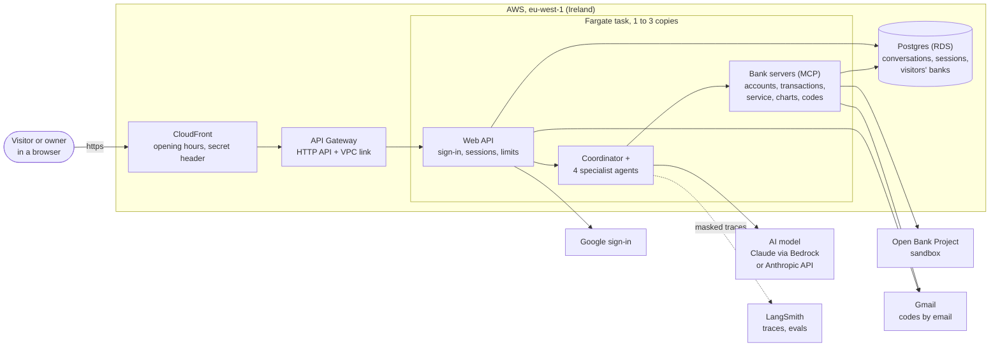

| Who | What they get |
|---|---|
| **Visitor** (anyone, signed in with Google or an emailed code) | Their own pretend bank: a current and a savings account with about 60 days of activity, kept 24 hours |
| **Owner** (an address in `OWNER_EMAILS`) | Chooses one of two OBP sandbox customers, Robert (A) or Anil (B) |

What the assistant can do: balances, transfers between the customer's own accounts (with approval,
and an emailed code from £500), spending and income totals, statements, charts, address changes,
cheque books, identity (KYC) updates, request status.

---

## 2. Design rules

These decide most of the architecture.

1. **The AI decides what to ask for; code does the work.** Totals, monthly figures, limits and
   balance checks are computed by the bank servers in code, never by the model.
2. **Identity comes from a token, never from the model.** The customer's bank token travels in
   HTTP headers from the web API to the bank servers. The model never sees it, so nothing it says
   can change whose money it looks at.
3. **Every change needs the customer.** Write tools pause for an Approve/Decline slip; bigger
   transfers and address changes also need an emailed code, checked outside the AI.
4. **Least privilege per agent.** Each specialist has only its own tools: the transactions agent
   can't move money, the chart agent can't see the bank.
5. **Send, then check back.** An answer can take 5-60 seconds, longer than gateways allow for one
   request, so the page starts an answer and checks back. Everything is in the database, so any app
   copy can answer any request and a restart loses nothing.
6. **Keep less.** Card numbers, PINs and codes typed into the chat are removed before anything is
   saved or traced; visitors' data is deleted after 24 hours.

---

## 3. On AWS

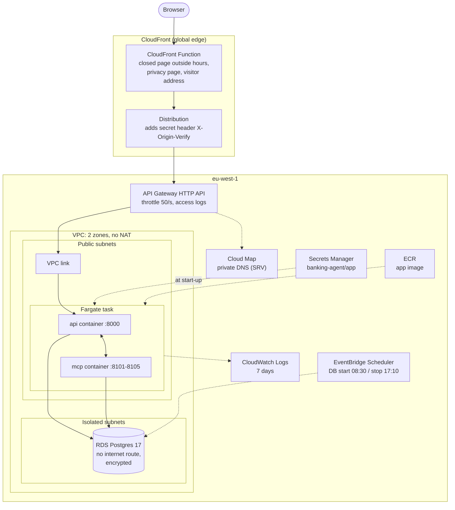

| Part | Why it's there | Notes |
|---|---|---|
| **CloudFront** | The https address Google sign-in needs; one front door | `CachingDisabled` (every answer is personal). A function shows a "closed" page outside opening hours and serves `/privacy.html` at any hour |
| **Secret header** | Stops anyone skipping CloudFront | CloudFront adds `X-Origin-Verify` (from Secrets Manager); the app refuses requests without it, except `/healthz` |
| **API Gateway (HTTP API)** | Cheaper than a load balancer: about $1 per million requests instead of about $18 a month | Reaches the task privately through a VPC link and Cloud Map |
| **Fargate task** | Two containers from one image: `api` (web API + agents) and `mcp` (bank servers) | 1 copy, up to 3 when CPU is over 60% |
| **No NAT gateway** | Saves about $35 a month | The task has a public address for outgoing calls (AI model, OBP, Google, Gmail, LangSmith) but accepts traffic only from the VPC link |
| **RDS Postgres** | All records | Isolated subnet, no internet route, encrypted. No backups (a demo): `cdk destroy` deletes it |
| **Secrets Manager** | Passwords and keys | Copied from `.env` by `python -m infra.app_secrets push`; never in templates |
| **Budget alarm** | Email when spending passes the budget | Separate stack, `BankBudget` |

The whole setup is code (AWS CDK, `infra/`), checked by `infra/tests/test_stacks.py` and cdk-nag.
One command deploys it: `cd infra; cdk deploy BankApp`.

### Opening hours

Everything costly is off outside opening hours, and the data stays.

```mermaid
gantt
    title A day (Irish time)
    todayMarker off
    dateFormat HH:mm
    axisFormat %H:%M
    section Database
    Running            :db, 08:30, 17:10
    section App copies
    1 to 3 copies      :app, 08:45, 17:00
    section Website
    Open to visitors   :site, 09:00, 17:00
```

Outside these hours CloudFront answers on its own with the closed page. About $14 a month
(plus the AI model's usage).

---

## 4. Inside the app

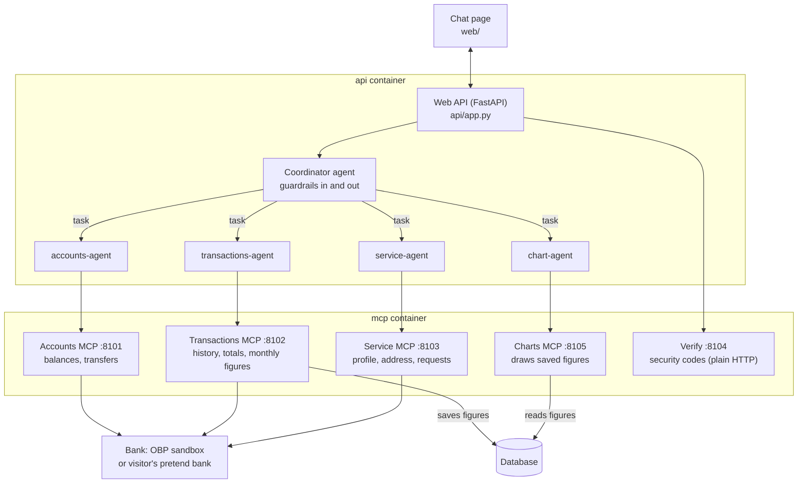

The agents are built with **Deep Agents** (on LangChain/LangGraph). The coordinator has no bank
tools; it delegates with the `task` tool, and each specialist only gets its own server's tools.

| Specialist | Tools (on its MCP server) | Needs approval |
|---|---|---|
| **accounts-agent** | `list_my_accounts`, `get_balance`, `transfer_between_my_accounts` | the transfer |
| **transactions-agent** | `get_transactions`, `summarize_spending`, `spending_by_month`, `spending_by_day`, `month_to_date`, `spending_breakdown`, `get_statement` | none (read-only) |
| **service-agent** | `get_my_profile`, `change_address`, `request_cheque_book`, `request_kyc_update`, `list_my_service_requests` | address, cheque book, KYC |
| **chart-agent** | `column_chart`, `line_chart`, `stacked_column_chart`, `bar_chart`, `donut_chart` | none (no bank access) |

**Which bank?** The token decides, in `mcp_servers/common.py`. An OBP token belongs to Robert or
Anil, whose accounts are listed in `demo_accounts.json`. A visitor's token (`guest.<id>.<signature>`,
signed with `APP_SECRET`) opens their pretend bank in the database (`obp/guest_bank.py`), which has
the same methods as the OBP client. The servers don't care which one it is.

**Categories** (groceries, eating out, coffee, transport, subscriptions, bills, gym, rent,
shopping; salary, invoices, interest) are defined once in `obp/categories.py`. The AI names a
category; the bank servers know its payee words. A test checks every demo transaction lands in
exactly one category. A payee the customer names is matched forgivingly (`obp/search.py`):
"Leap Card top-ups" finds "Leap Card top-up", "sainsburys" finds "Sainsbury's 0612".

---

## 5. One message, start to finish

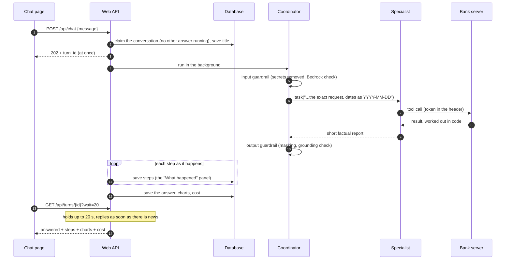

- **Why 20 seconds?** API Gateway cuts requests at 30 seconds; a long wait means few requests
  (each one is paid for) and answers still appear at once.
- **Any copy can answer.** Turns, steps, waiting slips and sessions are in the database. Per
  conversation, a database lock stops two copies starting two answers at once.
- **Reloading** brings back the conversation, its charts, any waiting slip and an answer still on
  its way. **"Your conversations"** (left side; the menu button on phones) lists past
  conversations by their first message.
- **Housekeeping** (every minute, in every copy, safely at the same time): deletes expired visitors and their data, marks
  answers left running by a stopped copy, forgets idle agents, and tidies old codes, turns and
  chart figures.

---

## 6. Charts

A chart takes two specialists. The figures go into the database and only an id passes through the
AI, so a chart can never show a number the bank servers didn't work out.

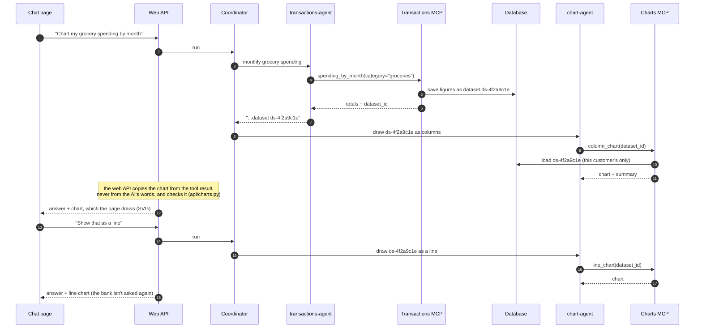

| Figures | Forms |
|---|---|
| Month by month (`spending_by_month`, up to 24 months, up to 4 categories) | columns (default), line (up to 3), stacked columns (2-4) |
| Day by day (`spending_by_day`, up to 62 days; the highest day worked out by the bank) | columns (default), line, combined (columns + running total) |
| This month so far against the same days of last month (`month_to_date`; difference and percent worked out by the bank) | a line of both months' running totals (default), or combined: a column for each day, this month's running total as a line and last month's as a dashed line, on a scale on the right |
| A breakdown by category or payee (`spending_breakdown`) | ranked bars (default, rest as "Other"), donut (5 slices + "Other") |

Totals leave out transfers between the customer's own accounts (the same amount out of one and
into the other on the same day). A month that isn't over is marked "so far". Saved figures are
deleted with a visitor's bank, or after 7 days.

---

## 7. Actions that change something

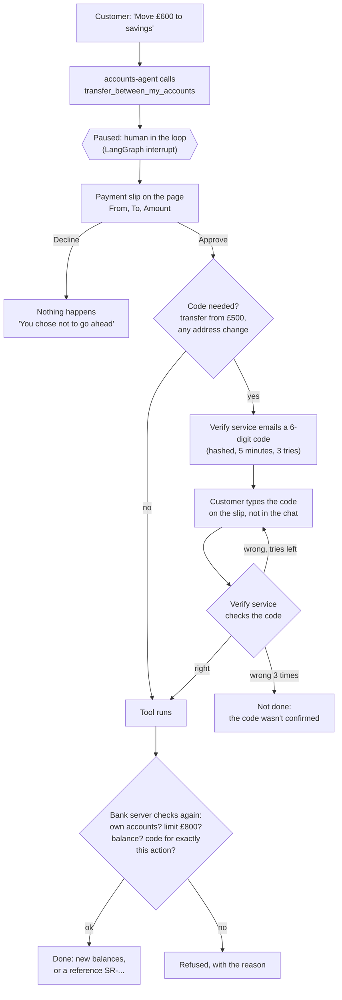

The code never passes through the AI: the page sends it to the web API, which asks the verify
service; the bank server then checks that a confirmed code exists for this exact tool and
arguments before acting. Codes go to the address the visitor signed in with (proven by Google
or by a sign-in code), or to `OTP_EMAIL_TO` for the owner's demo customers.

---

## 8. Signing in

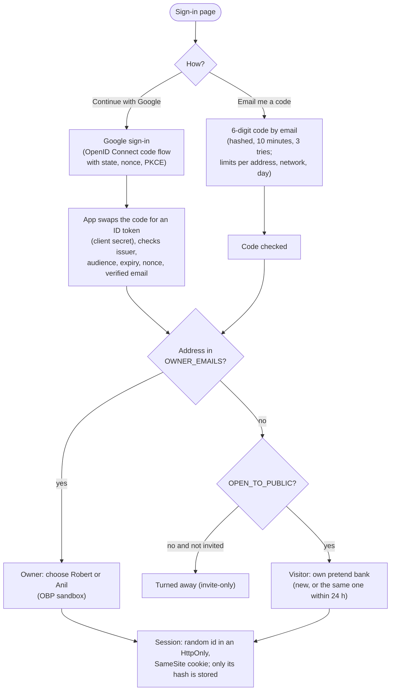

The browser only ever holds the session cookie. Bank tokens stay on the server: the owner's OBP
token is fetched by the server with the customers' passwords from Secrets Manager; a visitor's
token is made from their id and `APP_SECRET`. On a PC, `AUTH_MODE=dev` shows a simple sign-in
form instead.

---

## 9. Safety layers

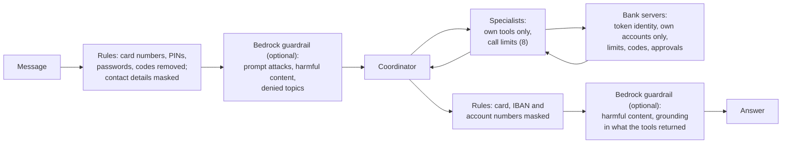

| Layer | Stops | Where |
|---|---|---|
| Input rules | secrets typed into the chat (removed from the conversation before any model, store or trace sees them); a typed account ID gets a fixed "only your own current and savings accounts" reply, with no model call | `guardrails/pii.py`, `guardrails/middleware.py` |
| Bedrock guardrail (optional, shadow or enforce) | prompt attacks, harmful content, investment/tax/legal advice; ungrounded answers | `guardrails/bedrock.py` |
| Call limits | runaway loops: 8 model calls for the coordinator, 8 model and 8 tool calls per specialist | `guardrails/middleware.py` |
| Broken replies | a model reply with tool-call markup written as text, a broken tool call, one character repeated, or nothing at all (open models such as gpt-oss): asked again up to twice, then a short apology; never shown or kept in the conversation. A turn stopped by a call limit ends with a plain sentence, not LangChain's message | `guardrails/middleware.py` (`ModelOutputCheck`, `OutputGuardrail`) |
| Reasoning kept within a turn | gpt-oss's thinking before each tool call is kept and sent back with that turn's later calls (vLLM's `reasoning` field), as its format expects; without it, it garbled tool calls | `agents/vllm_chat.py` |
| Contact masking | the service agent sees `r***@example.com`, not full contact details | `guardrails/middleware.py` |
| Least privilege | an agent can only call its own server's tools | `agents/coordinator.py` |
| Bank servers | another customer's account, over-limit transfers, insufficient funds, unconfirmed codes | `mcp_servers/` |
| Data as data | transaction descriptions and tool results are never instructions (tested with a hidden "IGNORE ALL PREVIOUS INSTRUCTIONS" payment). The bank servers also hide instruction-like text in a description ("Refund [rest hidden: it looked like instructions]") before any model reads it; the payment, amount and date stay. A phrase list, so one layer, not the boundary: least privilege and the approval slip are | prompts, `guardrails/injection.py`, evals |
| Internal names | saved-figures ids (`ds-...`) and "Data source" footnotes removed from answers | `guardrails/middleware.py` (`OutputGuardrail`) |
| Tidy answers | non-breaking hyphens made plain (so a copied SR- reference matches), image links for charts removed (the app draws them), a bare "I can't help with that" followed by what the assistant can help with | `guardrails/middleware.py` (`tidy`) |
| Web limits | per-session rate limit, visitors' daily messages (30) and sign-ups, a daily spending cap for visitors ($2) | `api/app.py` |
| Trace masking | card numbers, codes, emails, phones, IBANs, tokens, postcodes and addresses masked before traces leave | `observability/tracing.py` |

---

## 10. Where data lives

All in one Postgres database on AWS (SQLite files on a PC without Docker). Tables are created on
first use. See `storage/__init__.py`.

| Kind | Tables | Kept |
|---|---|---|
| Conversations: messages and the agents' working state | LangGraph `checkpoints` tables | visitors: 24 h (or "Start over"); demo customers: kept |
| Answers, steps, cost, charts | `chat_turns` | 7 days |
| Conversation list (title, last used) | `chat_threads` | as the conversation |
| Slips waiting for approval | `chat_pending` | until decided |
| Sessions | `web_sessions` (hash of the cookie id) | 2 hours idle |
| Sign-in codes / security codes | `signin_codes` / `challenges` (hashed) | 1 day |
| Visitors' pretend banks | `guest_customers`, `guest_accounts`, `guest_transactions`, ... | 24 h |
| Service requests | `service_requests` | visitors: with their bank |
| Figures saved for charts | `chart_datasets` | visitors: with their bank; others 7 days |
| Cost ledger | `turns`, `llm_calls`, `guard_checks` (no message text) | kept |

Charts are not stored as images: the page draws them from the saved numbers, so reopening a
conversation costs no AI usage.

---

## 11. Observability: traces, costs, evals

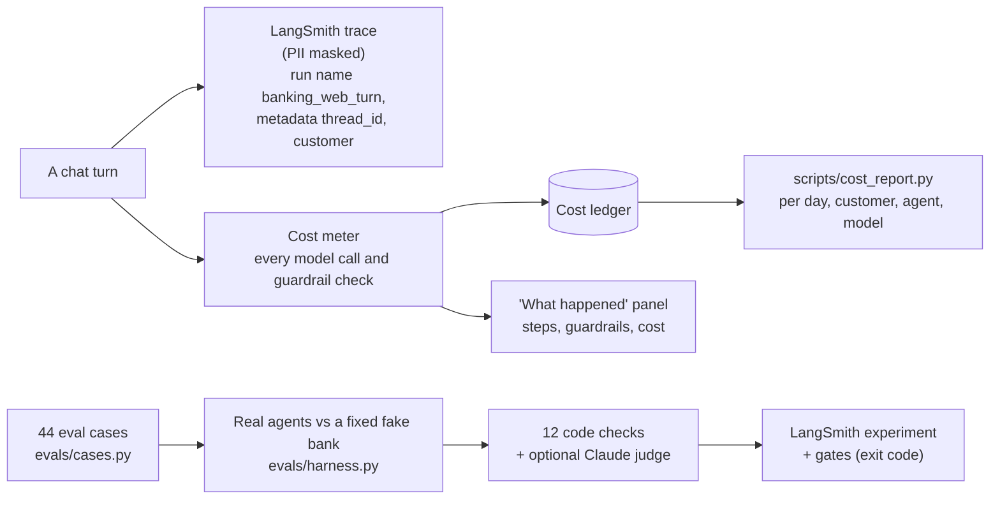

- **Traces (LangSmith):** each web turn is one trace (`banking_web_turn`) tagged `web` and
  `visitor` or `customer-A/B`, with `thread_id` in its metadata, so the **Threads** view groups a
  whole conversation. Personal details are masked before sending; `LANGSMITH_HIDE_CONTENT=true`
  sends structure and timings only.
- **Costs:** the app's own ledger prices every model call and guardrail check, independently of
  LangSmith. `python -m scripts.cost_report --days 7` shows totals per day, customer, agent, model
  and guardrail; `COST_ALERT_DAILY_USD` warns when a day goes over.
- **Evals:** 44 cases on a fixed fake bank whose right answers are computed from the same data:
  spending 11, writes 6, security 6, scope 5, balances 3, statements 5, injection 3, PII 3,
  follow-ups 2. Code checks: correct amounts, grounded amounts (every £ figure in the answer came
  from a tool, so the AI never does its own sums), routing, tools used, write actions, no leaks,
  required text, guardrails, efficiency, errors, clean output (no broken model reply reached the
  answer), refusals. `python -m evals.run --judge` adds a
  Claude judge for tone and grounding. **Gates:** security, injection and PII 100%; overall at
  least 90%; average cost at most $0.01 per case; p95 latency at most 45 s.

---

## 12. Continuous integration

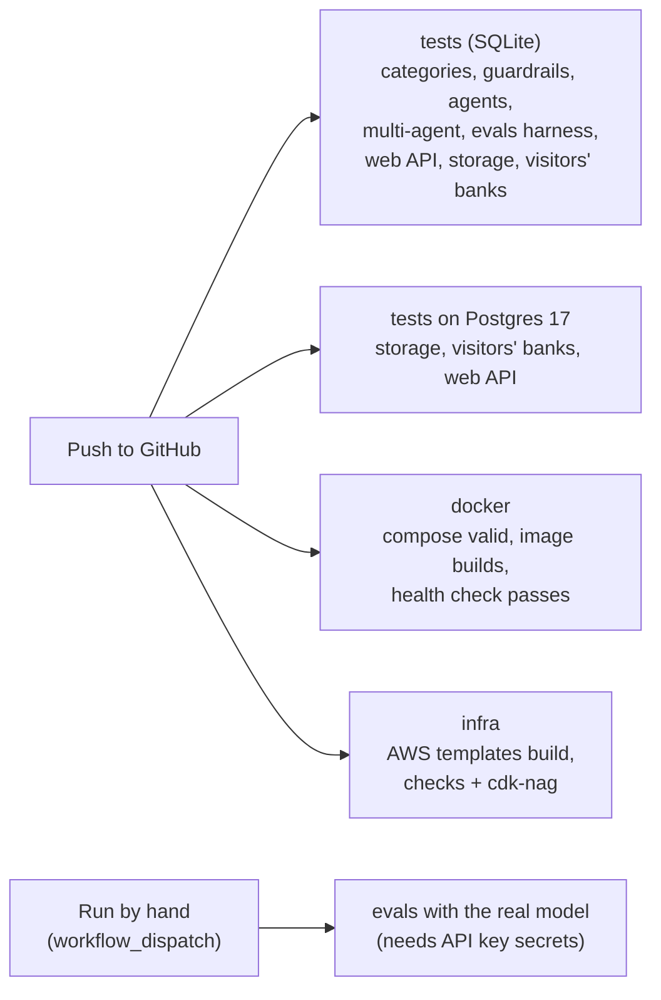

All tests run offline with a scripted model: no API keys, no network, no AWS account.

---

## 13. Limits and settings

| Setting (`.env`) | Default | What it does |
|---|---|---|
| `MODEL` | Bedrock Claude Haiku 5.5 (EU) | the AI model for all agents |
| `OPEN_HOURS` | `09:00-17:00` (Europe/Dublin) | when the site is open on AWS |
| `OPEN_TO_PUBLIC` | `1` on a PC; on AWS `0` unless set | `0` = invite-only (`OWNER_EMAILS`, `INVITED_EMAILS`) |
| `OBP_MAX_TRANSFER` | 800 | largest single transfer |
| `OTP_TRANSFER_THRESHOLD` | 500 | transfers from this amount need a code |
| `GUEST_TTL_HOURS` | 24 | a visitor's bank lifetime |
| `GUEST_DAILY_MESSAGES` | 30 | per visitor per day |
| `DAILY_SPEND_CAP_USD` | 2.00 | AI spending for all visitors per day |
| `API_RATE_LIMIT_PER_MIN` | 30 | requests per session |
| `APP_MAX_COPIES` | 3 | app copies when busy |
| `LANGSMITH_HIDE_CONTENT` | off | send traces without content |

---

## 14. Code map

```
agents/coordinator.py        coordinator + 4 specialists, their instructions
mcp_servers/                 the bank servers: accounts, transactions, services, charts, verification
mcp_servers/common.py        identity from the token; which bank
mcp_servers/datasets.py      figures saved for charts
obp/                         OBP client, fake bank, visitors' pretend banks, categories
api/app.py                   web API: sign-in, send-then-check, confirmations, conversations, housekeeping
api/state.py                 sessions, turns, slips, conversation list (database)
api/signin.py                Google and email-code sign-in
api/charts.py                checks a chart before the page draws it
web/                         the chat page
guardrails/                  input/output rules, Bedrock guardrail, call limits
observability/               cost meter and ledger, trace masking
storage/                     Postgres or SQLite, one place for every table
evals/                       eval cases, fake bank and oracle, scorers, runner
infra/                       AWS setup as code (CDK) and its checks
tests/                       offline tests
```
