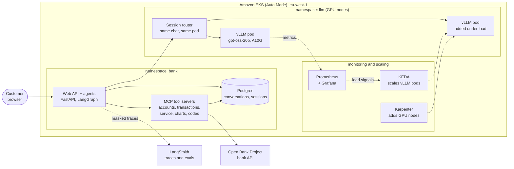
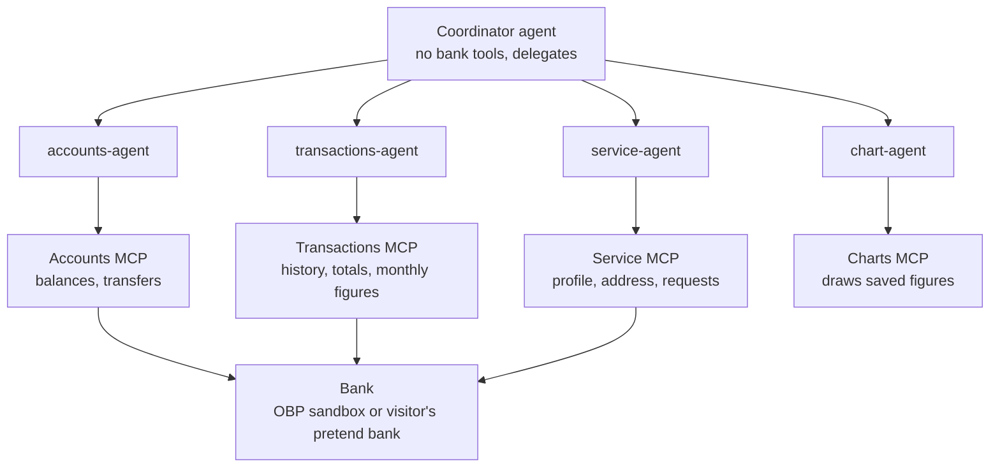
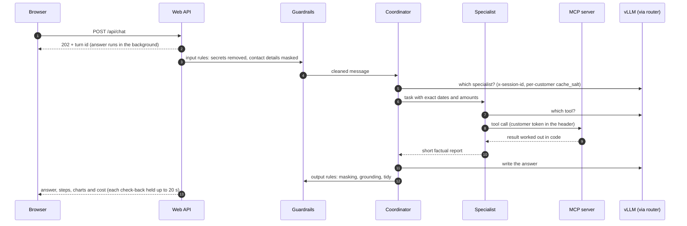
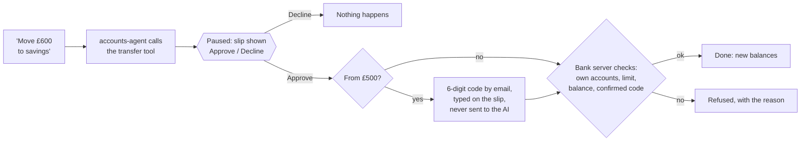
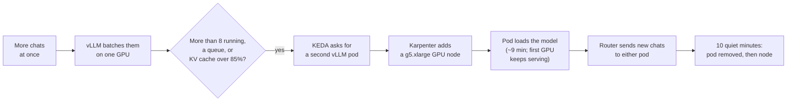

# Multi-Agent Banking Assistant on a Self-Hosted LLM


A banking assistant that answers questions and takes actions on live bank data. A **coordinator agent**
hands each request to **specialist agents** (accounts, transactions, service, charts). Each one can use only
its own **MCP tool server**, which talks to the bank. Customers ask things like *"How much did I spend on
groceries compared with last month?"* or *"Move £600 to savings"*. They get grounded answers and charts,
and anything that changes data waits for their approval.

The same app runs in two ways:

- **Claude on AWS** ([banking-agent](https://github.com/KrishanuDebnath24/banking-agent)): Claude via Amazon
  Bedrock, deployed with AWS CDK on ECS Fargate for about $14 a month.
- **Self-hosted (this repo):** the open-weight **gpt-oss-20b** served by **vLLM** on NVIDIA A10G GPUs, first
  on one GPU machine and then on **Amazon EKS** with GPU autoscaling, Prometheus and Grafana.

<p align="center">
  
  
</p>

## Highlights

| What | Result |
|---|---|
| Eval pass rate on the self-hosted model (44 cases, run twice) | **70% → 94%**, every gate passed, security cases 100% |
| Eval pass rate with Claude (40 cases) | **92%** overall, **100%** on security, $0.0005 per query |
| One A10G GPU, one request | **113 ms** to the first token, **9.6 ms** per token (~105 tokens/s) |
| Prefix caching on a 10-message chat | follow-ups start **8.5× faster** (873 → 102 ms); 90% of prompt tokens from cache |
| Throughput, one GPU | up to **7.4 requests/s** (~1,480 tokens/s); median first token under 1 s up to 8 at once |
| GPU autoscaling on EKS (KEDA + Karpenter) | second GPU serving in **~9 min**; **0 of 4,000** load-test requests failed |
| Simulated customers (Locust, one GPU) | 10 at once: **7.1 s** median per full answer, 0 errors |
| Tests | ~400 offline checks in CI with a scripted model: no API keys, no network |

## What it can do

- **Balances and statements** for the customer's own accounts.
- **Spending and income insights:** totals by category, payee or month, month-to-date, day-by-day
  comparisons. Every figure is calculated by the bank servers, never by the model.
- **Charts:** column, line, stacked, bar and donut, drawn in the page from saved figures.
- **Actions with approval:** transfers between own accounts, address changes, cheque books, KYC updates.
  Each one pauses for an Approve/Decline slip, and bigger ones need an emailed 6-digit code.
- **Two kinds of user:** the owner picks an Open Bank Project sandbox customer; visitors sign in with Google
  or an emailed code and get their own pretend bank for 24 hours.

## Architecture

### The system on Amazon EKS



Network policies allow only the paths shown: Postgres accepts only the API and MCP pods, MCP accepts only
the API, and the GPU pods accept only the router (plus monitoring and load tests).

### Agents and tools: least privilege



The customer's bank token travels in HTTP headers from the web API to the MCP servers, so **the model never
sees it** and nothing it writes can change whose money it looks at.

### One message, start to finish



### Actions that change data



### Autoscaling under load



The threshold of 8 comes from a benchmark: on one A10G, the time to the first token passes 1 second
beyond about 8 requests at once. A schedule keeps one GPU warm from 08:40 to 17:05 (Dublin time) and none
overnight. More diagrams (sign-in, safety layers, data, CI) are in **[ARCHITECTURE.md](ARCHITECTURE.md)**.

## Key design decisions

- **The AI decides what to ask for; code does the work.** Totals, monthly figures, limits and balance
  checks are calculated by the bank servers. An eval check fails any answer that contains a £ figure no
  tool returned, which stops the model from making up numbers.
- **Identity from a token, never from the model.** The bank token never enters a prompt.
- **A person approves every change.** Approval slips use LangGraph interrupts. Security codes are checked
  outside the AI, and the bank server checks a confirmed code exists for that exact action.
- **Least privilege per agent.** The transactions agent can't move money; the chart agent can't see the bank.
- **Prompts built for the cache.** The fixed part of every prompt comes first, and the date goes at the end.
  The router keeps each conversation on one GPU, and a per-customer `cache_salt` means cached text is never
  shared between customers.
- **Autoscale on what the model feels, not CPU:** running requests, queue length and KV cache use.
- **Measure before adopting.** EAGLE-3 speculative decoding was tested on real chats and made generation
  11–25% slower on this mixture-of-experts model, so it stays off (details below).

## Safety layers

| Layer | What it stops |
|---|---|
| Input rules | card numbers, PINs, passwords and codes typed into the chat are removed before any model, store or trace sees them |
| Prompt-injection handling | instruction-like text inside bank data is hidden before the model reads it; tested with a hidden "IGNORE ALL PREVIOUS INSTRUCTIONS" payment |
| Call limits | runaway loops: 8 model calls for the coordinator, 8 model and 8 tool calls per specialist |
| Broken-reply checks | open-model replies with tool markup as text, empty or repeated output: asked again, never shown |
| Bank servers | other customers' accounts, over-limit transfers, insufficient funds, unconfirmed codes |
| Output rules | account numbers and IBANs masked, internal IDs removed, answers tidied |
| Trace masking | personal details masked before traces reach LangSmith |
| Optional Bedrock Guardrails | prompt attacks, harmful content, ungrounded answers (Claude version) |

## Results

<p align="center">
  
</p>

**Quality (evals).** 44 cases on a fixed fake bank, across spending, writes, security, scope, balances,
statements, prompt injection, PII and follow-ups. 12 code checks (correct amounts, grounded amounts,
routing, tools used, no leaks and more), plus an optional Claude judge.

| Model | Pass rate | Security / injection / PII | Latency |
|---|---|---|---|
| gpt-oss-20b on vLLM (88 runs) | 94.3% (from 70% before prompt, tool and guardrail fixes) | 100% | p50 4.6 s, p95 24.8 s |
| Claude (40 cases) | 92% | 100% | p95 12.3 s, $0.0005 per query |

**Serving benchmarks** (one NVIDIA A10G, prompts with a 2,500-token shared start, 200-token answers):

| Requests at once | 1 | 8 | 32 | 128 |
|---|---|---|---|---|
| First token, median | 113 ms | 610 ms | 1.5 s | 4.4 s |
| Time per token, median | 9.6 ms | 17.4 ms | 29.4 ms | 64.6 ms |
| Output tokens/s (whole GPU) | 95 | 387 | 863 | 1,477 |

**Scaling on EKS (load test of 4,000 requests via the router):** 0 failures, 4.47 requests/s, median first
token 969 ms. First GPU from zero: 8 min 54 s. Second GPU under load: 9 min 17 s (1 min 34 s to decide,
7 min 43 s to pull the image and load the model).

**Speculative decoding (EAGLE-3):** only 22% of guessed tokens were accepted on banking chats, and each
check of several tokens costs about 2× a normal step on this mixture-of-experts model. Generation ran at
0.75× (3 guesses) and 0.89× (1 guess) of the baseline speed, so it isn't used.

## Things that went wrong, and the fixes

- **Garbled tool calls from gpt-oss.** Its reasoning has to be sent back with the same turn's later calls.
  Keeping it per turn fixed the broken replies.
- **The autoscaler saw "0 of 8" during the first EKS load test.** Prometheus wasn't scraping vLLM, because
  the chart's ServiceMonitor didn't match the pods. A corrected ServiceMonitor fixed it.
- **No GPU capacity.** AWS returned "insufficient capacity" for g5 machines in one zone. I moved the machine
  to another zone through an image, and pre-read the restored disk in parallel to cut a 30-minute model load.
- **Cold starts take ~9 minutes,** mostly image and model loading. A scheduled warm-up hides it at opening
  time; keeping one spare GPU in busy hours would hide it during the day.

## Tech stack

| Area | Tools |
|---|---|
| Agents | Python 3.12, LangGraph / Deep Agents, LangChain, MCP (Model Context Protocol), FastAPI |
| Models | gpt-oss-20b on vLLM 0.32 (prefix caching, continuous batching); Claude via Amazon Bedrock |
| Data | Postgres (LangGraph checkpoints, sessions, cost ledger), Open Bank Project API |
| Quality | 44-case eval suite with gates, LLM-as-a-judge, LangSmith tracing and experiments |
| Serving and scaling | Amazon EKS Auto Mode, Karpenter, KEDA, Helm, vLLM production-stack router |
| Observability | Prometheus, Grafana (12-panel dashboard), alert rules, per-agent cost ledger |
| Delivery | Docker, GitHub Actions CI, AWS CDK (Claude version), eksctl |
| Load testing | `vllm bench serve`, Locust |

## Run it

- **On a PC with Docker:** `docker compose up -d`, then open http://127.0.0.1:8000. The full steps are in
  **[SETUP.md](SETUP.md)**.
- **One GPU machine** (vLLM, Prometheus, Grafana, benchmarks): [deploy/phase0/README.md](deploy/phase0/README.md).
- **Amazon EKS** (GPU autoscaling, session routing): [deploy/k8s/README.md](deploy/k8s/README.md).
- **Tests:** `python tests/test_guardrails.py`, `python tests/test_api_offline.py` and the others in `tests/`,
  all offline.
- **Evals:** `python -m evals.run --judge`.

## Repository map

```text
agents/          coordinator, specialists, vLLM chat client (session header, cache salt, reasoning)
mcp_servers/     accounts, transactions, service and charts tool servers; security-code service
guardrails/      input and output rules, PII, prompt-injection handling, call limits
api/  web/       FastAPI web API and the chat page
evals/           44 eval cases, harness, scorers, gates
bench/           throughput sweep, prefix-cache test, Locust load test, result comparison
deploy/phase0/   one GPU machine: Docker Compose with vLLM, Prometheus, Grafana
deploy/k8s/      EKS: cluster, GPU node pool, vLLM Helm values, KEDA, network policies, load tests
tests/           offline tests with a scripted model and a fake vLLM server
```

## Screenshots

| | |
|---|---|
|  |  |
| The "What happened" panel: agents, tools, guardrails and cost for one answer | A LangSmith trace: coordinator → specialist → MCP tool calls |
|  |  |
| The eval report with every gate passed | Two vLLM pods on two GPU nodes after KEDA scaled out |

---

Built by **Krishanu Debnath**: [LinkedIn](https://www.linkedin.com/in/krishanu-debnath-24b7953b9/) ·
[GitHub](https://github.com/KrishanuDebnath24)
